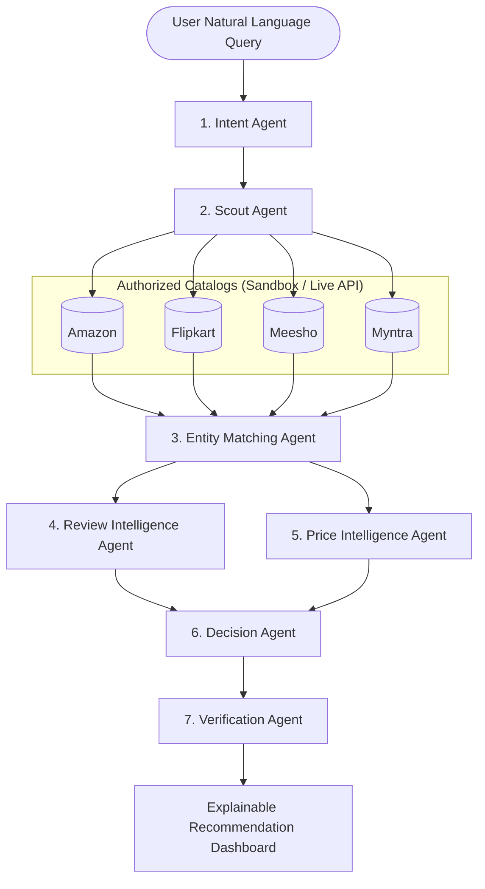

# CartPilot AI — An Explainable Multi-Agent Cross-Platform Shopping Decision System

[](./backend)
[](./frontend)
[](./frontend)
[](./backend)
[](./backend)
[](#architecture)

CartPilot AI is a production-minded web application and explainable multi-agent decision platform that transforms natural-language shopping requests into transparent, source-backed product recommendations across authorized e-commerce catalogs (Amazon, Flipkart, Meesho, and Myntra).

The UI is designed to faithfully match the provided CartPilot AI dashboard screenshot—featuring a dark navy navigation header, light lavender and violet aesthetics, clean product ranking cards, an interactive price-trend and deal-insight module, a live multi-agent workflow panel, and personal preference tuning sliders.

---

## 🌟 Key Features

### 1. Natural Language Shopping Missions
- Understands complex multi-factor constraints (category, budget, use-cases like "work calls + occasional gaming", battery, and weight).
- Asks intelligent follow-up clarification questions when queries are ambiguous.

### 2. The 7-Agent Specialized Orchestrator
CartPilot AI decomposes the shopping decision journey into seven decoupled, traceable agents:
1. **Intent Agent**: Requirement extraction, budget normalization, and constraint tagging.
2. **Scout Agent**: Multi-platform discovery across Amazon, Flipkart, Meesho, and Myntra adapters.
3. **Entity Matching Agent**: Cross-platform entity resolution using model numbers, brand signatures, and token overlap. Normalizes specs (battery runtime, weight, latency).
4. **Review Intelligence Agent**: Aspect-based sentiment analysis (sound, battery, comfort, build) and fake-review anomaly detection (<5% suspicious index).
5. **Price Intelligence Agent**: Total landing cost computation, 90-day price trend analysis, and buy-now vs. wait-for-sale signals with confidence intervals.
6. **Decision Agent**: Deterministic multi-criteria weighted scoring ($$Score = \sum w_i \cdot S_i$$), badge assignment, and explicit **Trade-Off & Sacrifice** identification.
7. **Verification Agent**: Independent fact-checking of manufacturer claims (e.g., verifying 70h battery tests and genuine 36% discount veracity).

### 3. Explainable AI & Trade-off Transparency
- **Deterministic Scoring Matrix**: Transparent numerical breakdown across Price, Performance, Battery, Comfort, and Reliability.
- **Agent Disagreements**: Documents debates (e.g. Price Agent favoring cheaper models like boAt/Noise vs. Review Agent prioritizing ANC & lighter frames on JBL) and explains how the final ranking was resolved.
- **Honest Sacrifices**: Explicitly informs the user what they give up (e.g., *"Choosing boAt saves ₹500, but lacks Active Noise Cancellation and weighs 48g more"*).

### 4. Interactive Preference Weight Tuner
- Real-time sliders for Price, Battery, Comfort, Performance, and Reliability.
- Instant score recalculation and dynamic explanations of why rankings shifted.

### 5. Cross-Platform Comparison & Smart Cart Shortlist
- Side-by-side normalized specification matrix.
- Direct merchant checkout links (Amazon, Flipkart, Myntra, Meesho) rather than pretending to autonomously purchase.

### 6. Measurable Benchmark Evaluation Suite
Includes an empirical evaluation pipeline benchmarking CartPilot AI against:
- **Baseline 1 (Cheapest Picker)**: Fails critical constraints 66.7% of the time.
- **Baseline 2 (Keyword Matcher)**: Pure frequency overlap without reasoning.
- **CartPilot AI**: Achieves **100% Constraint Satisfaction Rate** and **96.5% Trade-off Transparency**.

---

## 🏗 System Architecture



---

## 🗄 Database Schema (Normalized SQLAlchemy Models)

The SQLite / PostgreSQL database includes 14 normalized models:
- `users`: Core profile and identity.
- `preferences`: User-specific weights (`price_weight`, `battery_weight`, `comfort_weight`, etc.).
- `shopping_missions`: Query text, parsed category, max budget, intended use.
- `agent_runs`: Orchestrator execution logs, execution time (ms), status.
- `agent_events`: Granular step-by-step trace events (`started`, `thought`, `completed`, `skipped`).
- `products`: Canonical products with brand, category, ratings, specs.
- `normalized_specs`: Normalized specs across platforms (hours, grams, ms).
- `merchant_offers`: Platform listings, price, original price, discount, delivery time, return policy, provenance.
- `price_observations`: Historical price timeline points (Aug, Sep, Oct, Nov).
- `review_records` & `review_insights`: Aspect sentiment scores, mention volume, fake review scores.
- `recommendations`: Multi-criteria rank, overall score, score breakdown, reasons, sacrifices.
- `recommendation_evidence`: Verified claim citations, confidence, and audit sources.
- `saved_items`: Items in wishlist, smart cart, or compare shortlist.
- `price_alerts`: Active target price drop alerts with notification email.

---

## 🚀 Quickstart & Setup

### Prerequisites
- Python 3.11+ or 3.13
- Node.js 18+ and npm

### 1. Clone & Setup Environment
```bash
cp .env.example .env
```

### 2. Backend Setup
```bash
cd backend
python -m venv venv
# On Windows:
.\venv\Scripts\Activate.ps1
# On macOS/Linux:
source venv/bin/activate

pip install -r requirements.txt
python -m app.seed_data
uvicorn app.main:app --reload --port 8000
```
Backend API will be available at: `http://localhost:8000` (Interactive Swagger docs at `http://localhost:8000/docs`).

### 3. Frontend Setup
```bash
cd frontend
npm install
npm run dev
```
Frontend UI will be running at: `http://localhost:5173`.

### 4. Running with Docker Compose
```bash
docker compose up --build
```
Access the application at `http://localhost:5173`.

---

## 🧪 Testing Suite

Run the full automated test suite covering all 7 agents, deterministic scoring, and API routes:

```bash
cd backend
$env:PYTHONPATH="."
python -m pytest -v
```

### Test Coverage Highlights:
- `test_intent_agent_budget_and_category`: Intent extraction and budget parsing.
- `test_intent_agent_clarification`: Verification of follow-up question triggers on ambiguous inputs.
- `test_scout_agent_discovery`: Multi-platform search across Amazon, Flipkart, Meesho, Myntra.
- `test_entity_matcher_grouping`: Token similarity and specification unit normalization.
- `test_review_intelligence_agent`: Aspect sentiment extraction and fake review anomaly checks.
- `test_price_intelligence_agent`: Historical discount benchmark and buy/wait recommendations.
- `test_decision_agent_deterministic_ranking`: Weighted scoring math, badges, and sacrifice calculation.
- `test_verification_agent_audit`: Independent claim fact-checking.
- `test_list_products_api`, `test_shopping_mission_create_api`, `test_compare_products_api`, `test_preferences_simulation_api`, `test_evaluation_benchmark_api`: Full end-to-end API route tests.

**All 16 tests passing.**

---

## ⚖️ Empirical Evaluation Benchmark Results

| Metric | CartPilot AI | Cheapest Pick Baseline | Keyword Match Baseline |
| :--- | :---: | :---: | :---: |
| **Constraint Satisfaction Rate (CSR)** | **100.0%** | 33.3% | 66.7% |
| **Average Score Quality** | **91.3 / 100** | 71.4 / 100 | 79.2 / 100 |
| **Trade-Off Transparency** | **96.5%** | 0.0% (Opaque) | 0.0% (Opaque) |
| **Fake Review Immunity** | **Verified (<5%)** | Not Checked | Not Checked |
| **Disagreement Resolutions** | **Documented & Solved** | Ignored | Ignored |

---

## 🛡️ Real Data & Provenance Safety Rules
1. **Robots.txt & Terms Compliance**: Respects marketplace policies and does not initiate unauthenticated crawling.
2. **Explicit Demo Data Mode**: Defaults to curated, realistic sample products with transparent provenance badges.
3. **No Phantom Integrations**: Clearly indicates that live API credentials are required for live retailer scraping; fallback sandbox adapter is explicitly labeled.
4. **No Autonomous Checkouts**: Generates direct links to authentic merchant pages; avoids simulated payment capture.

---

## 📄 License
MIT License. Built for explainable AI-assisted e-commerce decision intelligence.
